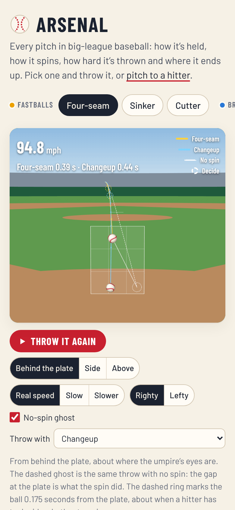
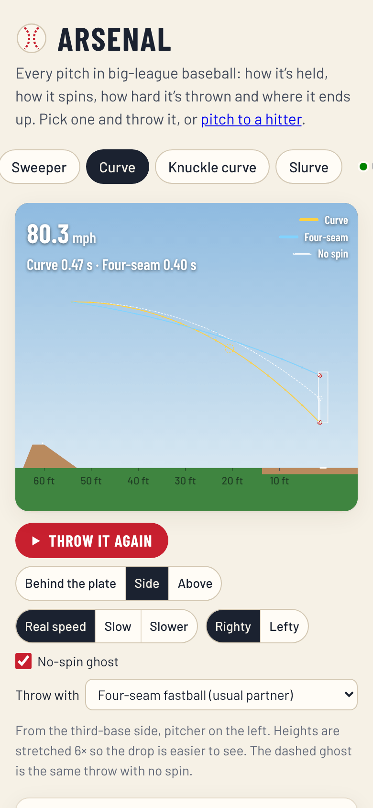
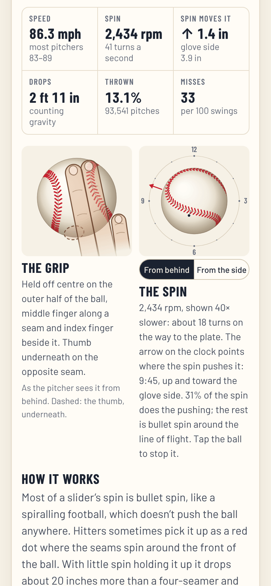
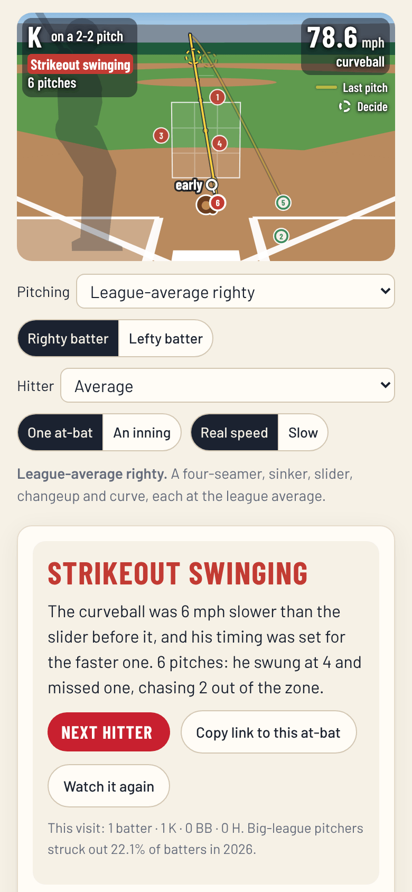

# Arsenal

**Use it: [junkdrawer.works/arsenal](https://junkdrawer.works/arsenal/)**

**Every pitch in big-league baseball: how it's held, how it spins, how hard it's thrown and where it ends up.** Pick a pitch and it's thrown from the mound to home plate, seen from behind the plate, from the side or from above, with a ghost of the same throw with no spin so you can see what the spin did. Next to it are the grip, the ball turning on its real spin axis, and the 2026 Statcast numbers for that pitch.

<p align="center">
  
  &nbsp;
  
  &nbsp;
  
  &nbsp;
  
</p>

## How it works

- **Thirteen pitches** in four groups: fastballs (four-seam, sinker, cutter), breaking balls (slider, sweeper, curveball, knuckle curve, slurve), off-speed (changeup, splitter, forkball) and oddities (knuckleball, eephus).
- **The throw.** Each pitch leaves a right-hander's hand (or a left-hander's) at its average speed, release height and extension, and is pushed by its average spin-induced movement on top of gravity and air drag, so it reaches the plate in the right time with the right break. The ball spins at its real rate the whole way, and the dots along its path are where it was every 1/30 of a second, so the farther apart they are, the faster it's going. Watch at real speed, slowed to a quarter, or to a twentieth.
- **The ghost** is the same throw with no spin. The gap between them at the plate is the movement Statcast measures. A dashed ring marks the ball 0.175 seconds from the plate, about when a hitter has to decide whether to swing.
- **Throw it with another pitch** to see two pitches leave the same release point together and split late, the way pitchers pair them.
- **The grip**, drawn as the pitcher sees it from behind, with see-through fingers so the seams show underneath.
- **The spin**, shown 40 times slower, from behind the pitcher (with a clock for the tilt) or from the side. A tap on the ball stops it and starts it again. The seam pattern follows the pitch: four seams a turn for a four-seamer, two for a sinker, the red dot of a slider's bullet spin.
- **The whole arsenal**: every pitch on one movement chart, and a table of how often each is thrown, how hard, and how often hitters miss it.
- **Pitch to a hitter.** Pick a pitcher (a league-average righty, or one of nine real 2026 arsenals, from Paul Skenes to Tyler Rogers's submarine sinker and Matt Waldron's knuckleball) and a righty or lefty batter. Call each pitch and one of 25 spots, the strike zone's nine boxes (framed on the grid) and the ring around them, and throw it; from a keyboard the pitches and the spots are one Tab stop each, picked with the arrow keys. Pitches miss their spots by a realistic amount. Each one is marked where it crossed the plate, with what happened and why: what the hitter was looking for, whether he picked it up, and where and when he swung. The at-bat ends with a scout's note on what decided it. "What would a catcher call?" suggests a typical call for the count, another each time it's asked, and says what big-league pitchers and hitters did in that count in 2026, "Throw each of his pitches 400 times from here" charts what every pitch in the arsenal does per 100 throws from the same count and spot, and what matters in that count: strikeouts with two strikes, walks with three balls, otherwise strikes and balls (once the at-bat is over, it charts the count and spot of its last pitch: what else he could have thrown there), and "Copy link to this at-bat" makes a link that replays it exactly. The address keeps that link as you pitch, so reloading the page picks the at-bat up where it was, and a phone's Share sends it.
- Links go straight to a pitch, like [junkdrawer.works/arsenal/#sweeper](https://junkdrawer.works/arsenal/#sweeper), and keep the pitch thrown with it and a left-hander: [#sweeper+sinker.lefty](https://junkdrawer.works/arsenal/#sweeper+sinker.lefty) is a lefty's sweeper thrown with his sinker. No account and nothing saved. It works offline and installs to a phone's home screen.

## The numbers

Every number is from Statcast, through Baseball Savant's search, for the 2026 regular season: 713,311 pitches. Averages weight each pitcher by how many of that pitch he threw. The knuckleball's count only the pitchers who threw at least 100 (in 2026, Matt Waldron alone), which leaves out position players' lobs; how often it was thrown, and by whom, still counts everyone. "Spin moves it" is the movement from spin alone (Statcast's induced vertical break and horizontal break); "Drops" is the total drop from release, gravity included. `node tools/statcast.mjs 2027` fetches a new season into `js/numbers.js`; the words in `js/pitches.js` quote a few of the 2026 figures, so read them over after a refresh.

The flight is a constant-acceleration model, like the one Statcast fits to each pitch: the speed, movement and release come from the data, and so does where it's thrown: each pitch lands where a right-hander's pitch of that kind crossed the plate on average to right-handed batters in 2026 (Statcast's plate_x and plate_z; the knuckleball's from Waldron's alone), mirrored for a left-hander. `node tools/statcast.mjs --aim` fetches only those aim points. The tests check that the model's total drop comes out within 12% of Statcast's (or 3 inches, whichever is more) for every pitch.

## The hitter

The at-bat is a coaching model, not physics, built on the same flight model. Before each pitch the hitter guesses fastball or not, from the count and what this pitcher throws, leaning toward whatever he just saw, and sits on one pitch. He reads the ball until the decision point, 0.175 seconds from the plate. If it isn't the pitch he's sitting on, he may still pick it up: less often when it comes out of the same tunnel as the pitch before. If he doesn't, he decides and swings as if it were the pitch he expected: where that pitch would cross the plate, and when, with his timing pulled a little toward the last pitch's speed. So a slider that looks like a fastball at the decision point is chased off the plate, and a changeup after two fastballs gets him out in front.

His knobs are tuned by `tools/calibrate.mjs` against the 2026 league, gathered by `tools/league.mjs` from Statcast: how often hitters swing in each of the 12 counts and miss when they do, how often they chase pitches out of the zone and miss those, how often taken pitches are called strikes, how each kind of pitch gets missed and lands in the zone, fouls, and what happens on balls in play. Each real pitcher's pitches are tuned to his own miss rates. Over thousands of at-bats it comes out within a point or two of the league on walks, swings, chases, misses and hits; strikeouts run about two points high (24% against 22%). `test/atbat.test.mjs` holds it there.

## Running it

It's a static site: plain HTML, CSS and JavaScript modules, with no build step.

```sh
npx serve .                   # or any static file server, then open the printed address
npm install                   # only for the tools below: esbuild and upng-js
npm test                      # the flight and at-bat models against the numbers, then the real page in Chromium (needs Playwright)
node tools/screenshots.mjs    # redraws docs/*.png and og.png
node tools/make-icons.mjs     # redraws the PNG icons from icon.svg
node tools/statcast.mjs       # refreshes js/numbers.js from Baseball Savant
node tools/league.mjs         # refreshes js/league.js, the at-bat's targets and the real pitchers' arsenals
node tools/calibrate.mjs      # retunes the at-bat model to js/league.js and writes js/atbat-params.js
npm run build                 # dist/arsenal.html, the whole thing in one file
```

To put it online with GitHub Pages: **Settings → Pages → Build and deployment → Deploy from a branch**, then pick `main` and `/ (root)`.

### Files

- `js/pitches.js`: the thirteen pitches: names, grips, how each works. `js/numbers.js`: the Statcast numbers, where each pitch is aimed among them, made by `tools/statcast.mjs`.
- `js/flight.js`: the flight model and the three cameras with their scenery. `js/stage.js`: the animation.
- `js/ball.js`: the baseball, drawn from the real seam curve with 108 stitches. `js/grip.js`: the grips. `js/spin.js`: the spin panel and tilt.
- `js/charts.js`: the movement chart and the table. `js/app.js`: the page. `js/math3.js`: small 3D helpers.
- `js/atbat.js`: the at-bat model: the hitter, the count, a pitcher who calls his own pitches, and the runs behind the 400 throws. `js/atbat-params.js`: its tuned knobs. `js/league.js`: the league numbers it's tuned to and the real arsenals. `js/atbat-words.js`: what each pitch did and why, in words. `js/atbat-ui.js`: the section on the page. `js/tracker.js`: the pitch marks, the batter's box and the at-bat's view, fitted to the screen. `js/rng.js`: the seeded random numbers that let a link replay an at-bat.
- `fonts/`: Barlow and Barlow Condensed (SIL Open Font License), served from here so nothing loads from elsewhere.
- `sw.js`: keeps a copy for using offline, and opens from it when the connection is up but not answering. `FILES` in it is a fingerprint of the files it keeps, so a release replaces the whole copy at once; the e2e test says what to set it to.
- `test/atbat.test.mjs` plays every pitch of every pitcher to every spot, replays an at-bat from its seed, checks the count's rules, and runs the lab (`test/lab.mjs`): thousands of at-bats measured against the league overall, in every count, for each kind of pitch and for each real pitcher's pitches, plus that a changeup after a fastball fools him more than one after a changeup.
- `test/physics.test.mjs` checks that every pitch but the knuckleball, which wobbles, lands where it's aimed and that the gap to its ghost is the Statcast movement; that every pitch's drop is close to Statcast's; the flight times; the tilt clock; and that the at-bat's view marks a pitch at the ground and shows the pitcher's hand on a phone, a computer and a tablet. `test/e2e.mjs` picks pitches every way the page offers, throws them from every camera, pairs two, switches hands, pitches to a hitter by tapping on a 390px and a 320px phone and on a phone held sideways and with the keyboard's arrow keys, checks what a screen reader hears for each pitch, reloads partway through an at-bat, and checks it opens offline, opens from its copy within 8 seconds when the connection stalls, and takes a new release's copy from the server. It serves the site under /arsenal/ the way GitHub Pages does, with a ten-minute cache.
