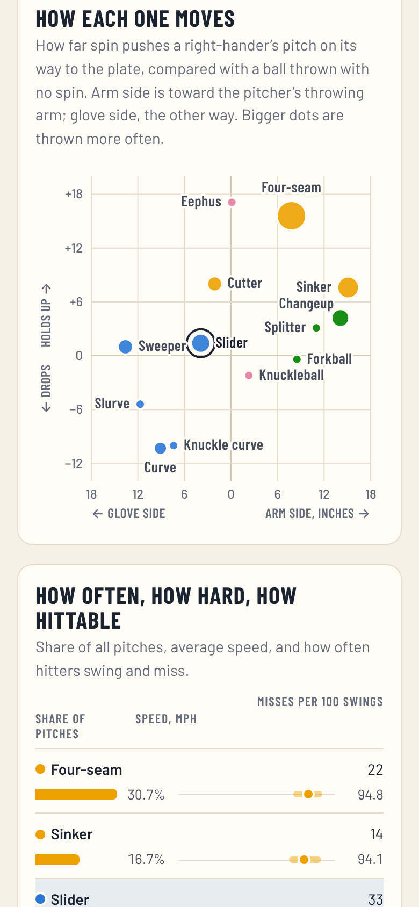
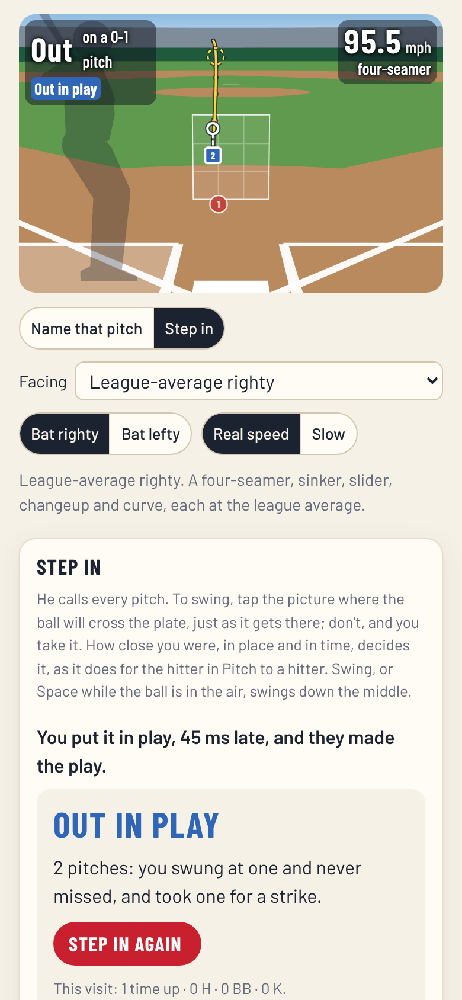

# Arsenal

**Use it: [junkdrawer.works/arsenal](https://junkdrawer.works/arsenal/)**

**Every pitch in big-league baseball: how it's held, how it spins, how hard it's thrown and where it ends up.** Pick a pitch and it's thrown from the mound to home plate, seen from behind the plate, from the side or from above, with a ghost of the same throw with no spin so you can see what the spin did. Next to it are the grip, the ball turning on its real spin axis, and the 2026 Statcast numbers for that pitch.

<p align="center">
  
  &nbsp;
  
  &nbsp;
  
  &nbsp;
  
  &nbsp;
  
  &nbsp;
  
</p>

## How it works

- **Thirteen pitches** in four groups: fastballs (four-seam, sinker, cutter), breaking balls (slider, sweeper, curveball, knuckle curve, slurve), off-speed (changeup, splitter, forkball) and oddities (knuckleball, eephus).
- **The throw.** Each pitch leaves a right-hander's hand (or a left-hander's) at its average speed, release height and extension, and is pushed by its average spin-induced movement on top of gravity and air drag, so it reaches the plate in the right time with the right break. The ball spins at its real rate the whole way, and the dots along its path are where it was every 1/30 of a second, so the farther apart they are, the faster it's going. Watch at real speed, slowed to a quarter, or to a twentieth.
- **The ghost** is the same throw with no spin. The gap between them at the plate is the movement Statcast measures. A dashed ring marks the ball 0.175 seconds from the plate, about when a hitter has to decide whether to swing.
- **Throw it with another pitch** to see two pitches leave the same release point together and split late, the way pitchers pair them.
- **The grip**, drawn as the pitcher sees it from behind, with see-through fingers so the seams show underneath. Under the grip of every pitch but the fastballs and the changeup, a line from Pitch Smart, MLB and USA Baseball's guidelines for young pitchers: stick to fastballs and changeups through age 12, and add breaking pitches once both are consistent.
- **The spin**, shown 40 times slower, from behind the pitcher or from the side. The ball turns on its spin axis as Hawk-Eye measured it, and the clock behind it has a red arrow for where the pitch moves and a thin line for where its spin itself points; where the two are half an hour or more apart, the card says so: the sinker's spin points to 1:30, but it moves toward 2:00, and the seams add the rest. A tap on the ball stops it and starts it again. The seam pattern follows the pitch: four seams a turn for a four-seamer, two for a sinker, the red dot of a slider's bullet spin.
- **The whole arsenal**: every pitch on one movement chart, and a table of how often each is thrown, how hard, and how often hitters miss it.
- **Pitch to a hitter.** Pick a pitcher (a league-average righty, or one of nine real 2026 arsenals, from Paul Skenes to Tyler Rogers's submarine sinker and Matt Waldron's knuckleball) and a righty or lefty batter (each pitch's share beside it is of what that pitcher threw to that side of the plate in 2026), and the kind of hitter: the average one, or a free swinger, a patient, contact or power hitter. Under the pitcher's line, "His pitches" (folded away on a phone) puts his pitches on a small movement chart, each joined to a ring for the league's average of its kind (Sale's slider sweeps 12.6 inches to the glove side, the league's 3.9), with a row for each: its speed, its share of his pitches to that side of the plate and how often hitters missed it when they swung, his own 2026 numbers. Call each pitch and one of 25 spots, the strike zone's nine boxes (framed on the grid) and the ring around them, and throw it; from a keyboard the pitches and the spots are one Tab stop each, picked with the arrow keys. Pitches miss their spots by a realistic amount, and each comes in at its own speed. The batter stands in his box on the picture, a flat figure you can see through, his knees and the letters on his chest level with the bottom and top of the strike zone, and a catcher's mitt shows where the pitch is called from the moment a spot is picked. Each pitch is marked where it crossed the plate, a strike with a red disc, a ball with a green ring and a ball in play with a blue square, with a thin line back to the mitt when it missed by more than 6 inches, and what happened in a tag of its mark's colour over the picture (a pitch that crosses on top of an earlier one leaves an outline of the earlier one's colour showing round it). Its speed is big in the top-right corner, as on a stadium's radar board. With Sound on (it starts off, and nothing plays until Throw is tapped with it on), each pitch you throw is heard as it lands: a low pop as the catcher's mitt takes a ball, a called strike or a swing and miss, the crack of the bat on a foul or a ball in play, a softer tick and then the mitt for a foul tip, and a dull thud for a hit batter, all made in the browser, so there are no sound files to download. The last pitch's path stays faint under the new one, with its decision ring, so two pitches out of the same tunnel are seen to look alike until the decision point and then split, and at Slow the hitter's read comes up as the ball reaches the decision point ("Sitting on the slider · swings"). Once a pitch is in, a small ring shows where he swung at it, with "early" or "late" beside it when he missed out in front or behind (for a strike he took thinking it would miss, where he thought it would cross), and the words say why: what the hitter was looking for, whether he picked it up, and where and when he swung. Each pitch in the log under it opens its own why when it's tapped, one at a time, and brings its mark to the front of the picture with the mitt where it was called and where he swung. After a ball called on a pitch within 3 inches of the zone, "Challenge the call" settles it as 2026's ABS challenge did: a strike if any part of the ball touched the zone, overturned and the challenge kept, or the call stands and it's used up, two to an at-bat (each club started a game with two and kept those that succeeded: MLB, "MLB announces ABS Challenge System coming to the Major Leagues beginning in the 2026 season", September 23, 2025). The at-bat ends with a scout's note on what decided it, "Watch it again", which throws its pitches again from the first, lighting each row of the log as its mark goes on, and under Next hitter a tally of the visit's batters ("This visit: 3 batters · 1 K · 0 BB · 1 H") beside the 22.1% big-league pitchers struck out in 2026. "An inning", beside the hitter, is batter after batter of that side and kind until three are out, with the outs over the picture, where the inning stands after each batter, its own end card at the third out, and two challenges for the whole inning. "What would a catcher call?" suggests a typical call for the count and the batter's side, another each time it's asked, and says what big-league pitchers and hitters did in that count in 2026, "Throw each of his pitches 400 times from here" charts what every pitch in the arsenal does per 100 throws from the same count and spot, against the hitter as he stands after everything he has seen, and what matters in that count: strikeouts with two strikes, walks with three balls, otherwise strikes and balls (once the at-bat is over, it charts the count and spot of its last pitch: what else he could have thrown there), "Show what the slider does at each spot", under the grid, shades each of the 25 spots by what the pitch picked does there from the count as it stands, 400 throws a spot, the same throws as the chart's, with the number in it (strikeouts per 100 with two strikes, strikes otherwise) and the hits under it, as Statcast's zone charts do, until the next pitch, and "Copy link to this at-bat" makes a link that replays it exactly on the same version of the hitter (on a phone that can share, "Share this at-bat" sends it through the phone's own share sheet, with how it went). A link carries that version: one made against an earlier hitter still opens and replays, on today's, with a line under the pitch log saying the same calls may play out differently. A call whose ball was challenged has a c after its spot (`FF1c`), and an inning's link is the same with `inning` for `ab` and every pitch of the inning in turn, like `#inning.v3.skenes.R.k3x9a.FF6.SL23`; a shared one offers "Watch it from the first pitch" under the line saying it was replayed from a link. The address keeps that link as you pitch, so reloading the page picks the at-bat up where it was, and a phone's Share sends it. A link that arrives cut off, or with a full stop or bracket from a message on the end, replays as much as can be read and says what was left out.
- **Be the hitter.** Name that pitch throws one of a pitcher's pitches the way he throws it to your side, from behind the plate at real speed or Slow, with only the ball drawn and no speed; once it's in, a button for each of his pitches asks what it was, and it says what and how fast, keeps a streak for the visit and throws it again with its path. Step in is a whole at-bat from the other side: he calls every pitch, only the ball comes in, and a tap on the picture is a swing, where and when it's tapped (Swing, or Space while the ball is in the air, swings down the middle from a keyboard); no tap and you take it. The picture marks where it crossed and where you swung, early or late, and the words say how far off you were.
- Links go straight to a pitch, like [junkdrawer.works/arsenal/#sweeper](https://junkdrawer.works/arsenal/#sweeper), and keep the pitch thrown with it and a left-hander: [#sweeper+sinker.lefty](https://junkdrawer.works/arsenal/#sweeper+sinker.lefty) is a lefty's sweeper thrown with his sinker. No account and nothing saved. It works offline and installs to a phone's home screen.

## The numbers

Every number is from Statcast, through Baseball Savant's search, for the 2026 regular season: 713,311 pitches. Averages weight each pitcher by how many of that pitch he threw. The knuckleball's count only the pitchers who threw at least 100 (in 2026, Matt Waldron alone), which leaves out position players' lobs; how often it was thrown, and by whom, still counts everyone. "Spin moves it" is the movement from spin alone (Statcast's induced vertical break and horizontal break); "Drops" is the total drop from release, gravity included. `node tools/statcast.mjs 2027` fetches a new season into `js/numbers.js`; the words in `js/pitches.js` quote a few of the 2026 figures, so read them over after a refresh.

The flight is a constant-acceleration model, like the one Statcast fits to each pitch: the speed, movement and release come from the data, and so does where it's thrown: each pitch lands where a right-hander's pitch of that kind crossed the plate on average to right-handed batters in 2026 (Statcast's plate_x and plate_z; the knuckleball's from Waldron's alone), mirrored for a left-hander. `node tools/statcast.mjs --aim` fetches only those aim points. Which way each pitch's spin itself points comes from Savant's spin-direction leaderboard (Hawk-Eye's measured spin axis, for every pitcher with at least 10 of the pitch, which counts knuckle curves as curves), averaged as directions and weighted the same way, with a left-hander's mirrored; `--spin` fetches only those. The tests check that the model's total drop comes out within 12% of Statcast's (or 3 inches, whichever is more) for every pitch.

## The hitter

The at-bat is a coaching model, not physics, built on the same flight model. Before each pitch the hitter guesses fastball or not, from the count and what he expects of this pitcher: the pitcher's 2026 mix to his side of the plate, and what he has thrown so far in the at-bat and what followed the last pitch earlier in it, so the same pitch every time, or the same two in turn, gets figured out. Then he sits on one pitch. He reads the ball until the decision point, 0.175 seconds from the plate. If it isn't the pitch he's sitting on, he may still pick it up: less often when it comes out of the same tunnel as the pitch before. If he doesn't, he decides and swings as if it were the pitch he expected: where that pitch would cross the plate, and when. So a slider that looks like a fastball at the decision point is chased off the plate, and a changeup he takes for a fastball gets him out in front. Changeups and splitters get chased more than other pitches, and curves taken more in the zone, as in 2026. Where a pitch crosses matters as it did in 2026: one on the corners is missed almost twice as often as one over the middle, and one that crosses where earlier pitches in the at-bat did gets hit harder. A miss now and then is a foul tip, a strike in any count. Every pitch comes in at its own speed, spread about the pitcher's average as his were in 2026.

The batter's side matters as it did in 2026. A batter on the pitcher's own side of the plate strikes out a little more, walks less, chases a little more and hits him a little softer: a .304 wOBA in 2026 (weighted on-base average, Statcast's measure of what each way of reaching base is worth), against .323 on the other side. Each pitcher throws his own mix to each side: Chris Sale threw his sinker on a third of his pitches to left-handed batters and almost never to right-handed ones, and right-handers threw changeups three times as often to left-handed batters. And each pitch goes to the side it breaks to: to a batter on the other side, a sinker runs away from him, a changeup or splitter goes down and away, and a slider, curve or cutter in or away about as often.

The hitter can be the average one or one of four kinds, each like a quarter of 2026's 135 qualified hitters (those with 502 plate appearances or more, enough for the batting title: 3.1 for each of his team's 162 games, Official Baseball Rules 9.22(a)), whose chases out of the zone ran from 15% to 45%: a free swinger, like the quarter who chased most (38% of pitches out of the zone); patient, like the quarter who chased least (22%); contact, like the quarter who missed least (16% of their swings); and power, like the quarter with the most extra bases per at-bat (a home run on 8% of the balls they put in play). Each is a small change to the average hitter's swings in the zone and out of it, his misses and his damage on contact, tuned until he chases and misses within a point or so of his quarter. A link carries the kind on the batter's side, like `#ab.v3.sale.L-patient.k3x9a.FF6`.

The strike zone is 2026's: the plate's width, between the season's average top and bottom of the zone (1.62 to 3.22 feet; in 2026, the first season of the automated ball-strike challenges, each batter's zone was set from his height), and a ball touching any edge of it is a strike. The umpire's zone shifts with the count, as 2026's umpires' did: more strikes called at 3-0 than at 0-2.

In Step in your swing takes the place of his read: where you tapped and how early or late, with his contact, the pitch's stuff, the count, the reach, the speed, the corners and the platoon split, but not the touch he gets on even a fooled swing (one nowhere near the ball misses it), and with a miss across the plate counting half one up or down, since the bat is long that way. A tap within a person's spread of the ball's arrival (30 ms either way, and 2 inches of where it crosses) touches about three-quarters of the league-average righty's pitches in the zone, one tapped anywhere at any time 2 or 3%, and real pitchers' from about a third (Mason Miller) to four-fifths (Matt Waldron).

His knobs are tuned by `tools/calibrate.mjs` against the 2026 league, gathered by `tools/league.mjs` from Statcast: how often hitters swing in each of the 12 counts and miss when they do (foul tips count as misses, as Statcast counts them), how much of their contact they foul off in each count, how often taken pitches are called strikes in each count, how often they chase pitches out of the zone and miss those, how each kind of pitch gets swung at, chased, missed and lands in the zone, misses and damage by where pitches cross, what happens on balls in play, and the platoon split: how batters on the pitcher's own side of the plate did against batters on the other. Each real pitcher's pitches are tuned to his own miss rates, and his strikeouts, walks and wOBA to his own (his walks through how well he hits his spots, his damage through how many balls in play fall for hits), and the knuckleball is as wild as Waldron's was, with as many in the zone. His timing is tuned too: in 2026 a pitch right after one 6 mph faster or slower was missed no more often than one right after the same pitch, so it isn't pulled toward the last pitch's speed. Breaking balls with two strikes get missed most below the zone and least over the middle, as 2026's did (per 100 thrown: about 20 below the zone, against 21 in 2026, and 4 over the middle, against 8), though more often above the zone than 2026's (17 per 100, against 9). Over thousands of at-bats it comes out within a point or two of the league on walks, swings, chases, misses, fouls, called strikes and hits; strikeouts run within a point of the league's (22% against 22%), and at-bats are as long, 3.9 pitches. Thrown down the middle every pitch, one pitch to one spot every time, or the same two pitches in turn, a pitcher does clearly worse than with his own calls, with three exceptions: Mason Miller and Tyler Rogers, whose stuff is missed (Miller's) or hit weakly (Rogers's) wherever it crosses, do about as well down the middle every pitch, which walks nobody; Matt Waldron, whose knuckleball's wobble the hitter can't read however often he's seen it, does better with the knuckleball to one spot; and a two-pitch closer's two pitches in turn do about as well as his own calls, which are much the same thing (Mason Miller's four-seamer up and slider down and away strike out 46%, against his real 47%). `test/atbat.test.mjs` holds it there.

## Running it

It's a static site: plain HTML, CSS and JavaScript modules, with no build step.

```sh
npm start                     # serves it at http://localhost:8080 (any static file server will do)
npm install                   # esbuild and upng-js, for the one-file copy in npm test and the tools below
npm test                      # the flight and at-bat models against the numbers, then the real page and the one-file copy in Chromium (needs Playwright)
node tools/screenshots.mjs    # redraws docs/*.png and og.png, the link preview: a throw, its grip and the README's strikeout on a strike zone
node tools/make-icons.mjs     # redraws the PNG icons from icon.svg
node tools/statcast.mjs       # refreshes js/numbers.js from Baseball Savant
node tools/league.mjs         # refreshes js/league.js, the at-bat's targets and the real pitchers' arsenals (about ten minutes; --cache=DIR keeps the downloads)
node tools/calibrate.mjs      # retunes the at-bat model to js/league.js and writes js/atbat-params.js
npm run build                 # dist/arsenal.html, the whole thing in one file
```

The retuning keeps its best round, fits each real pitcher's pitches last so nothing after undoes them, and then puts the knobs to the same checks as `test/atbat.test.mjs`, on three seeds pooled: if any fails, it says which and writes nothing. It is seeded (seed 1, or `--seed=N` for another search) and dated by `js/league.js`, so the same league numbers and the same starting knobs write the same `js/atbat-params.js`, byte for byte; `--out=PATH` writes it somewhere else, to compare two runs. It starts from the knobs already in that file, so a second run into it moves them again, and new knobs change how old at-bat links replay: raise `VERSION` in `js/atbat.js` with them, and the pinned links in `test/atbat.test.mjs` say when to.

To put it online with GitHub Pages: **Settings → Pages → Build and deployment → Deploy from a branch**, then pick `main` and `/ (root)`.

### Files

- `js/pitches.js`: the thirteen pitches: names, grips, how each works. `js/numbers.js`: the Statcast numbers, where each pitch is aimed among them, made by `tools/statcast.mjs`.
- `js/flight.js`: the flight model and the three cameras with their scenery. `js/stage.js`: the animation.
- `js/ball.js`: the baseball, drawn from the real seam curve with 108 stitches. `js/grip.js`: the grips. `js/spin.js`: the spin panel and tilt.
- `js/charts.js`: the movement chart and the table, and the small movement chart of one pitcher's pitches. `js/app.js`: the page. `js/math3.js`: small 3D helpers.
- `js/atbat.js`: the at-bat model: the hitter, the count, a pitcher who calls his own pitches, the runs behind the 400 throws, and the at-bat links, written and read. `js/atbat-params.js`: its tuned knobs. `js/league.js`: the league numbers it's tuned to and the real arsenals. `js/atbat-words.js`: what each pitch did and why, in words. `js/atbat-ui.js`: the section on the page. `js/hit-ui.js`: Be the hitter, Name that pitch and Step in. `js/sound.js`: the at-bat's sounds, made in the browser. `js/tracker.js`: the pitch marks, the batter in his box, the catcher's mitt, where the hitter swung and the at-bat's view, fitted to the screen. `js/rng.js`: the seeded random numbers that let a link replay an at-bat.
- `fonts/`: Barlow and Barlow Condensed (SIL Open Font License), served from here so nothing loads from elsewhere.
- `sw.js`: keeps a copy for using offline, and opens from it when the connection is up but not answering. `FILES` in it is a fingerprint of the files it keeps, so a release replaces the whole copy at once; the e2e test says what to set it to.
- `test/atbat.test.mjs` plays every pitch of every pitcher to every spot, replays an at-bat from its seed, writes and reads the links of 2,000 at-bats called at random, at every pitch of each, and of 60 innings, each played to three outs and nothing after, challenges a called ball in 1,500 at-bats (overturned when it touched the zone, the count with it, the link replaying it), and reads links cut off or with something on the end, replays five pinned links pitch by pitch, so a change to how the hitter plays fails until his version goes up, checks the count's rules, and runs the lab (`test/lab.mjs`): thousands of at-bats on three seeds pooled, measured against the league overall, in every count (swings, misses, fouls and called strikes), for each kind of pitch (misses, swings in the zone and chases), by where pitches crossed (misses and wOBA on contact), where breaking balls with two strikes are missed most and least (below the zone and over the middle, as in 2026, and on the map of the spots fewer down the middle than in the dirt for the league-average righty's slider and curve and Nola's knuckle curve at 0-2), and for each real pitcher's pitches, strikeouts, walks and wOBA, and Waldron's knuckleballs in the zone, and the platoon split, a batter on the pitcher's side of the plate against one on the other, each against 2026's two lines on that side, and each kind of hitter against his quarter of the qualified hitters (chases and misses per swing within 3 points on every seed), plus that a changeup after a fastball fools him more than one after a changeup, that throwing down the middle every pitch, one pitch to one spot or two in turn does clearly worse than a pitcher's own calls (and no better, for Miller and Rogers down the middle), and that Miller's four-seamer up and slider down and away in turn strike out under 50% on every seed, and that 400 throws of each pitch from one count and spot put the same pitch on top whatever the seed, against a hitter who remembers the whole at-bat, and that in Step in a well-timed tap touches 55 to 90% of the league-average righty's pitches in the zone, fewer of Miller's and Misiorowski's, and a tap at random under 10%. It reads the words of thousands of at-bats, the pitchers' own calls and those 2,000 random ones, for what reads badly: idioms, American spellings, a decision point blamed when the pitches were far apart or the same kind, his timing blamed when he wasn't out in front, and weak contact said the wrong way round for where the pitch crossed; and it checks that every speed in a real pitcher's line is one of his pitches', and that this README's strikeouts are within a point of the lab's and the league's and its count of pitches is the season's.
- `test/physics.test.mjs` checks that every pitch is aimed where Statcast's crossed the plate, that every one but the knuckleball, which wobbles, lands there, and that the gap to its ghost is the Statcast movement; that every pitch's drop is close to Statcast's; the flight times; that the clock's arrow is where each pitch moves and its thin line where its spin points, by the numbers, and that the ball turns on an axis square to that, on the card and in flight; that the at-bat's view marks a pitch at the ground and shows the pitcher's hand on a phone, a computer and a tablet; that the paths, the ghost, the strike zone and the chalk are as thick on a phone as on a computer; that strikes, balls and balls in play are marked with discs, rings and squares in the end card's colours, their numbers at 4.9 to 1 or more, that the newest mark grows in as it lands and a mark covered by a later one keeps an outline showing; that the batter stands in his box with his knees and letters level with the zone, turned round for a left-handed batter, clear of every spot off the plate inside on a phone, a computer and a tablet; and that the catcher's target is under the pitch with the line to a pitch that missed it under its mark, where the hitter swung is a small ring under the marks with its word over them, and the last pitch's path and decision ring are drawn faint under the new one. `test/e2e.mjs` picks pitches every way the page offers, throws them from every camera, pairs two and checks what the caption says about them, checks that the paths stand out on the light sky, switches hands, dismisses the movement chart's tooltip with Escape, stops the spinning ball, pitches to a hitter by tapping on a 390px and a 320px phone and on a phone held sideways and with the keyboard's arrow keys, checks what a screen reader hears for each pitch, that the Pitch Smart line is under the grip of every pitch but the fastballs and the changeup, that the spin words say where the thin line points and, for the pitches whose spin and movement are half an hour apart, that the seams add the rest, that each pitch's share follows the batter's side, picks a kind of hitter and reloads with him, reloads partway through an at-bat, opens at-bat links with a full stop or a bracket on the end, cut off or garbled, or made against another version of the hitter, and #Sweeper in capitals, checks that no line of the log starts with its separating dot at 390 and 320px, that the count and what happened over the at-bat's picture's top-left corner, and the radar board and its key in the top-right, never cover a pitch thrown high and off the plate (at 320, 360 and 390px, sideways and on a tablet, to either batter) and that what happened is in a tag that reads at 4.5 to 1, that the log's numbers are in their marks' shapes and read at 4.5 to 1 in both palettes, that the catcher's mitt follows the spot picked and a line runs to a pitch that missed it by more than 6 inches, that the ring for where the hitter swung is the last pitch's and comes once it's in, that the last pitch stays faint under the next with its key, and that at Slow the hitter's read shows from the decision point to the plate, and never at real speed, that a row of the log opens its why and brings its mark to the front, one at a time, that Watch it again throws the at-bat's own pitches again, lighting each row, from the end card and from a shared link, that a phone that can share sends the link through a stand-in share sheet and a computer copies it, that his pitches are open on a computer and folded on a phone, with his speeds, shares and misses and a ring for the league's average of each, that the map of the spots fills every spot, matches the chart at the spot picked, follows the pitch picked, waits while a pitch is in the air, clears on the next and reads at 4.5 to 1 in both palettes, that Sound makes and plays nothing until it's on and Throw is tapped, and then the right sound for each pitch thrown, but not for a link's, that the visit's tally counts the batters pitched to here, that an inning goes batter by batter to three outs with its own end card and its link replays it, that a challenge overturns a ball that touched the zone and the link keeps it, that Name that pitch shows only the ball until it's named, and that a tap on the ball in Step in is on time and on the ball, that no green line shows along either picture's bottom edge on a computer, that the dark palette's stadium lights are seen whole, clear of the words, that the call fits under the at-bat's picture from the first pitch to Throw for every pitcher on an iPhone 14 with Safari's bars tucked away (390x750), that Aaron Nola's "Knuckle curve" keeps to one line at 320 and 360px, that the buttons are reached 44px tall without a neighbour taking the tap and the lists are in 16px words, which an iPhone doesn't zoom into, that two pitches' times stay clear of the legend at 320, 360 and 375px, that the time over the picture is written only when it changes, that a pitch picked far down the page waits at the release until the picture is back in view, and that the lede's link goes down to Pitch to a hitter; it asks Chrome whether it can be installed, opens an at-bat link on a tablet either way up and on a computer in both palettes, and checks it opens offline, opens from its copy within 8 seconds when the connection stalls, and takes a new release's copy from the server. It serves the site under /arsenal/ the way GitHub Pages does, with a ten-minute cache.
- `test/single.mjs` builds the one-file copy and opens it the way a host shows one, written into a frame on another page that may run scripts and nothing else: the lede's link goes down to Pitch to a hitter without the frame leaving the copy, an at-bat plays to its end, and nothing goes wrong on the way.
