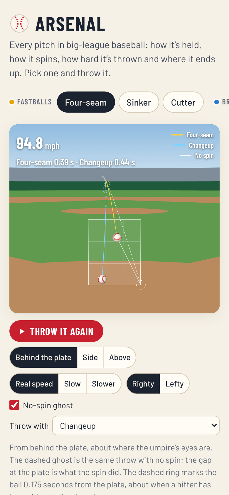
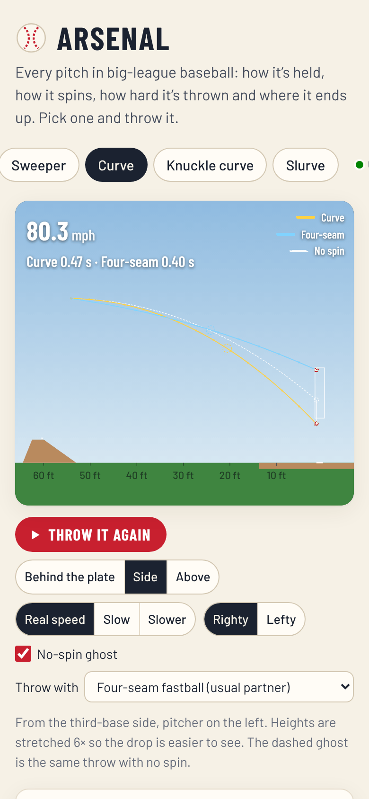
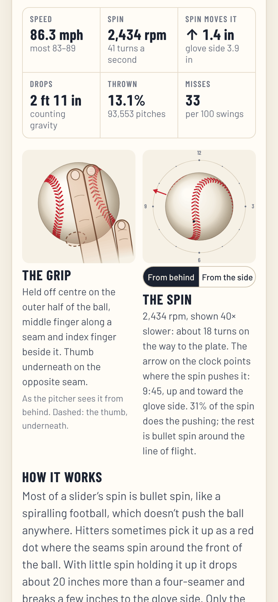

# Arsenal

**Use it: [junkdrawer.works/arsenal](https://junkdrawer.works/arsenal/)**

**Every pitch in big-league baseball: how it's held, how it spins, how hard it's thrown and where it ends up.** Pick a pitch and it's thrown from the mound to home plate, seen from behind the plate, from the side or from above, with a ghost of the same throw with no spin so you can see what the spin did. Next to it are the grip, the ball turning on its real spin axis, and the 2026 Statcast numbers for that pitch.

<p align="center">
  
  &nbsp;
  
  &nbsp;
  
</p>

## How it works

- **Thirteen pitches** in four groups: fastballs (four-seam, sinker, cutter), breaking balls (slider, sweeper, curveball, knuckle curve, slurve), off-speed (changeup, splitter, forkball) and oddities (knuckleball, eephus).
- **The throw.** Each pitch leaves a right-hander's hand (or a left-hander's) at its average speed, release height and extension, and is pushed by its average spin-induced movement on top of gravity and air drag, so it reaches the plate in the right time with the right break. The ball spins at its real rate the whole way. Watch at real speed, slowed to a quarter, or to a twentieth.
- **The ghost** is the same throw with no spin. The gap between them at the plate is the movement Statcast measures. A dashed ring marks the ball 0.175 seconds from the plate, about when a hitter has to decide whether to swing.
- **Throw it with another pitch** to see two pitches leave the same release point together and split late, the way pitchers pair them.
- **The grip**, drawn as the pitcher sees it from behind, with see-through fingers so the seams show underneath.
- **The spin**, shown 40 times slower, from behind the pitcher (with a clock for the tilt) or from the side. The seam pattern follows the pitch: four seams a turn for a four-seamer, two for a sinker, the red dot of a slider's bullet spin.
- **The whole arsenal**: every pitch on one movement chart, and a table of how often each is thrown, how hard, and how often hitters miss it.
- Links go straight to a pitch, like [junkdrawer.works/arsenal/#sweeper](https://junkdrawer.works/arsenal/#sweeper). No account and nothing saved. It works offline and installs to a phone's home screen.

## The numbers

Every number is from Statcast, through Baseball Savant's search, for the 2026 regular season: 713,309 pitches. Averages weight each pitcher by how many of that pitch he threw. "Spin moves it" is the movement from spin alone (Statcast's induced vertical break and horizontal break); "Drops" is the total drop from release, gravity included. `node tools/statcast.mjs 2027` fetches a new season into `js/numbers.js`; the words in `js/pitches.js` quote a few of the 2026 figures, so read them over after a refresh.

The flight is a constant-acceleration model, like the one Statcast fits to each pitch: the speed, movement and release come from the data, and the aim is worked out so the pitch lands where that kind of pitch usually does. The tests check that the model's total drop comes out within 12% of Statcast's (or 3 inches, whichever is more) for every pitch but the knuckleball.

## Running it

It's a static site: plain HTML, CSS and JavaScript modules, with no build step.

```sh
npx serve .                   # or any static file server, then open the printed address
npm install                   # only for the tools below: esbuild and upng-js
npm test                      # the flight model against the numbers, then the real page in Chromium (needs Playwright)
node tools/screenshots.mjs    # redraws docs/*.png and og.png
node tools/make-icons.mjs     # redraws the PNG icons from icon.svg
node tools/statcast.mjs       # refreshes js/numbers.js from Baseball Savant
npm run build                 # dist/arsenal.html, the whole thing in one file
```

To put it online with GitHub Pages: **Settings → Pages → Build and deployment → Deploy from a branch**, then pick `main` and `/ (root)`.

### Files

- `js/pitches.js`: the thirteen pitches: names, grips, how each works, where it's aimed. `js/numbers.js`: the Statcast numbers, made by `tools/statcast.mjs`.
- `js/flight.js`: the flight model and the three cameras with their scenery. `js/stage.js`: the animation.
- `js/ball.js`: the baseball, drawn from the real seam curve with 108 stitches. `js/grip.js`: the grips. `js/spin.js`: the spin panel and tilt.
- `js/charts.js`: the movement chart and the table. `js/app.js`: the page. `js/math3.js`: small 3D helpers.
- `fonts/`: Barlow and Barlow Condensed (SIL Open Font License), served from here so nothing loads from elsewhere.
- `sw.js`: keeps a copy for using offline.
- `test/physics.test.mjs` checks that every pitch but the knuckleball, which wobbles, lands where it's aimed, that the gap to its ghost is the Statcast movement and its drop is close to Statcast's, the flight times, and the tilt clock. `test/e2e.mjs` picks pitches every way the page offers, throws them from every camera, pairs two, switches hands, and checks it works offline.
